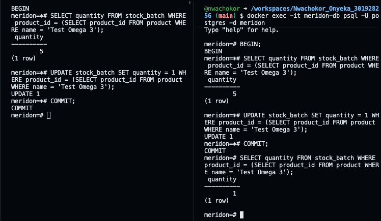
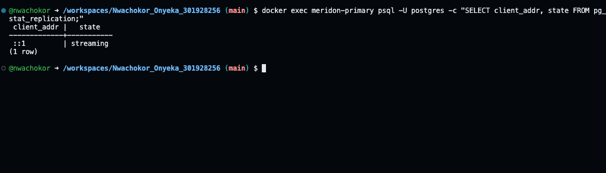

# MIT 8103 Advanced Database Systems Final Documentation

**Name:** Nwachokor Onyeka
**Student ID:** 301928256
**GitHub repository:** https://github.com/nwachokor/Nwachokor_Onyeka_301928256

## 1. Selected organisation: Meridon Store
Meridon Store is a simulated online store in Lagos that sells supplements for people and pets (dogs and cats). It only sells online, has two warehouses (Mainland and Island), uses its own riders for delivery, and tracks stock in batches with expiry dates. Customers confirm a delivery with a code. I wrote 18 business rules for the store, and every portfolio builds on this same case study.

## 2. Summary of the portfolio

### Portfolio 1: Database design
I designed 10 tables: Warehouse, Customer, Product, StockBatch, Orders, OrderItem, Payment, Staff, Rider and Delivery. I normalised the design to 3NF, added primary keys, foreign keys, unique and check constraints, and wrote four triggers for rules that simple constraints can't handle, for example stopping a delivery status from going backwards. Some repeated data, like the unit price on an order item, I kept on purpose as a snapshot of what the customer actually paid. One limitation I documented is that I can't trace a recalled batch back to the customers who bought it.

### Portfolio 2: Query optimisation
I loaded realistic test data (5,000 customers and 50,000 orders), wrote five queries based on real business questions, and compared execution plans before and after adding indexes. Order history went from 4.2 ms to 0.17 ms (about 24 times faster) and daily revenue got about 4 times faster. Best sellers only improved by about 13%, because most of the work there is joining and adding up thousands of rows, which an index can't skip.

### Portfolio 3: Transactions and concurrency
Using a test product with exactly 5 tubs, I showed a commit (order saved, stock 5 to 3) and a rollback (order for 10 refused, nothing saved). With two sessions running at once, I showed read committed and repeatable read isolation. I then created a lost update where 8 tubs were sold from 5, and fixed it with SELECT ... FOR UPDATE so the second customer waits and sees the real stock.

### Portfolio 4: NoSQL
I stored product reviews in MongoDB, because reviews don't all have the same fields: pet reviews have pet details, and some have photos, sub-ratings or staff replies. I inserted 10 reviews and ran queries on nested fields and arrays, an aggregation for average rating per product, an update, and an index that the query plan used (IXSCAN). Orders, stock and payments stay in PostgreSQL because they need strict rules and transactions.

### Portfolio 5: Distributed and cloud databases
I set up a PostgreSQL primary and a read-only replica in Docker. I showed the replica streaming, an order written on the primary showing up on the replica, and the replica refusing writes. My first attempt failed because the containers couldn't reach each other in Codespaces, and I fixed it by running the replica through the primary's network on port 5433. I also discussed availability versus consistency, sharding by warehouse (possible, but not needed at Meridon's size) and cloud deployment.

## 3. Evidence
Each portfolio folder has its own screenshots. Key ones:

| Portfolio | Screenshot | What it shows |
|---|---|---|
| 1 | 03-tables-list.png, 04-product-constraints.png | All 10 tables created, product constraints |
| 2 | seed_loaded.png, q2_result.png, indexes_created.png | Data loaded, query result, indexes created |
| 3 | race_result.png, fix_result.png | Overselling without locking, and the fix |
| 4 | reviews_inserted.png, q4_result.png, q6_index_plan.png | Reviews inserted, aggregation, index used |
| 5 | replication_streaming.png, replica_read.png, replica_write_refused.png | Replication working, replica is read-only |

## 4. Individual reflection
I wouldn't say any part was really difficult, but query optimisation was the biggest challenge. Turning the design I built in Portfolio 1 into seed data, queries and indexes that actually worked together took a lot of thinking. Transactions and concurrency came next. The steps were simple, but there was a lot of back and forth: two sessions, running things before and after commit, waiting for locks, and redoing steps when something didn't run properly. It was more tedious than hard.

The thing I learned that was new to me is that two sessions can work on the same database at the same time, and one can't see the other's changes until they're committed. Seeing Session B still showing 5 tubs while Session A had already changed it made isolation make sense to me in a way reading about it wouldn't have.

If I did this again, I'd pick a smaller system. For an assignment of this size, a store with deliveries, riders, warehouses and payments was a lot to build and explain. Something leaner, like a simple LMS, would have let me cover the same concepts with less work.

## 5. AI use declaration
I used Claude (Anthropic) during this portfolio, including Claude Code to review my files.

- **My own work:** The Meridon Store idea, the first users and data, and design choices like splitting pet products into cats and dogs came from me. I wrote my first ideas on paper before using AI.
- **What AI helped with:** Fleshing out the full scope (for example adding staff and admin users and refining product categories), writing and improving SQL and MongoDB queries, explaining terminal and Docker commands, troubleshooting errors, and drafting documentation.
- **How I checked it:** I ran every script and query myself, and all results, timings and screenshots come from my own runs. I reviewed and edited the written files so they reflect my understanding, and I left out anything I couldn't explain myself.

## 6. References
- PostgreSQL Global Development Group. *PostgreSQL 16 Documentation*. https://www.postgresql.org/docs/16/
- MongoDB, Inc. *MongoDB Manual*. https://www.mongodb.com/docs/manual/
- Docker, Inc. *Docker Documentation*. https://docs.docker.com/