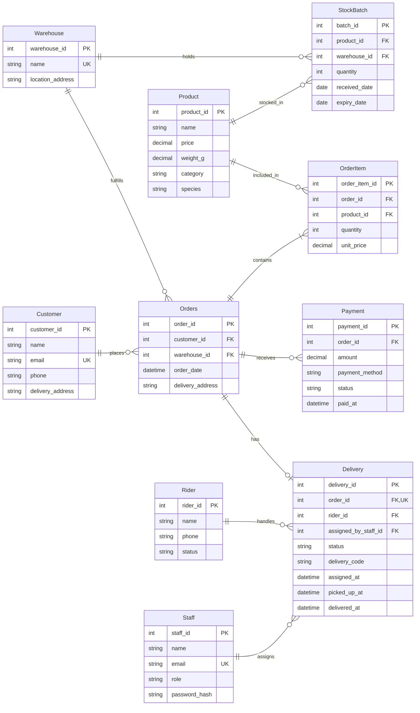

# Meridon Store ER Diagram

## ER diagram

## Primary keys (PK)
Every table has its own ID column, like customer_id or product_id, and that's its primary key. No two rows can have the same ID, and it can never be empty. That's how the database tells rows apart. Two customers could both be called Ada and live on the same street, but they'd still have different customer_ids, so they're never mixed up.

## Foreign keys (FK)
A foreign key is a column that holds another table's ID, so it points to a row in that table. For example, Orders.customer_id says which customer placed the order. The database only lets it hold an ID that actually exists, so you can't save an order for customer 9999 if there's no customer 9999. The table with the foreign key is always the "many" side: one customer can have many orders, but each order has only one customer.

## Unique columns (UK)
A unique column can't have the same value twice. I used it for customer email (rule 18), so two accounts can't share one email, and for staff email and warehouse name. Delivery.order_id is unique too, which is what makes it one delivery per order (rule 15).

## Reading the lines
Each end of a line shows how many rows can be on that side:
- `||` exactly one
- `o|` zero or one
- `o{` zero or many
- `|{` one or many

Some Meridon examples:
- **Customer ||--o{ Orders:** a new customer can sign up and have no orders yet, but every order belongs to exactly one customer.
- **Orders ||--|{ OrderItem:** an order has at least one item (rule 9). The diagram shows the rule, and a trigger in the schema enforces it.
- **Orders ||--o| Delivery:** an order can exist without a delivery, because a delivery is only created after payment. The diagram allows that gap, and a trigger enforces the "no delivery until paid" part (rule 14).

## Delivery timestamps
picked_up_at and delivered_at are empty when a delivery is first assigned. They get filled in as the status moves forward, and the schema checks that they match the status. A delivery marked 'picked_up' must have picked_up_at, and one marked 'delivered' must have both.